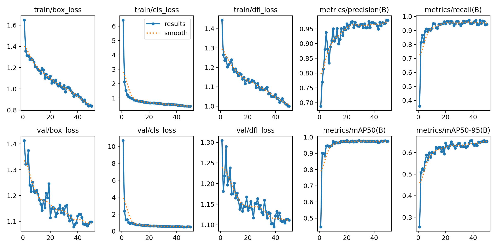
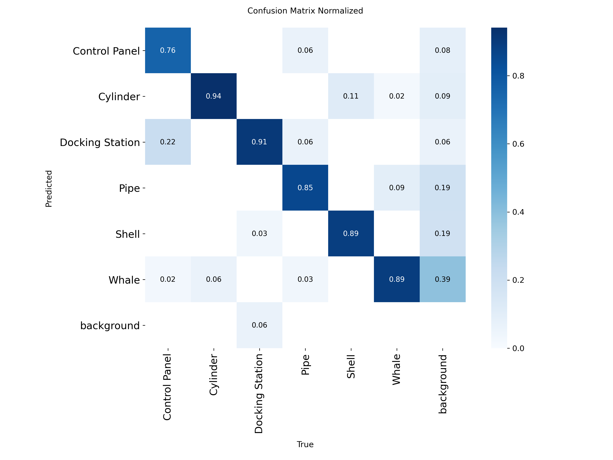
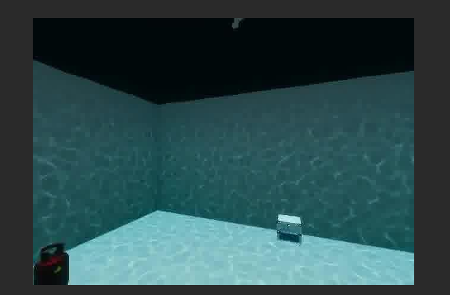
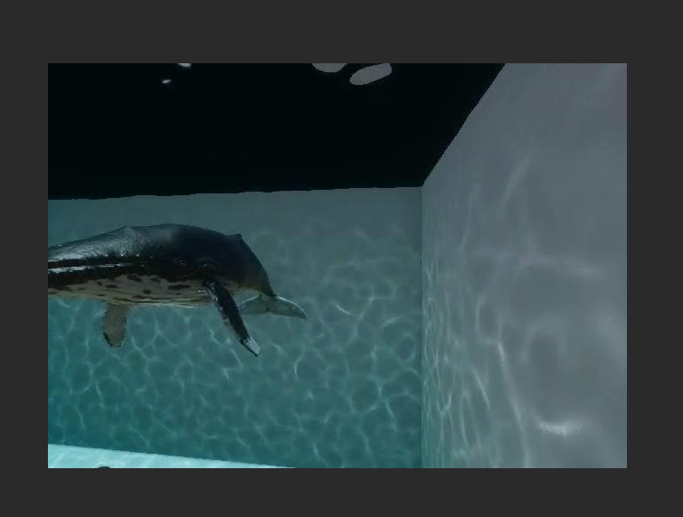
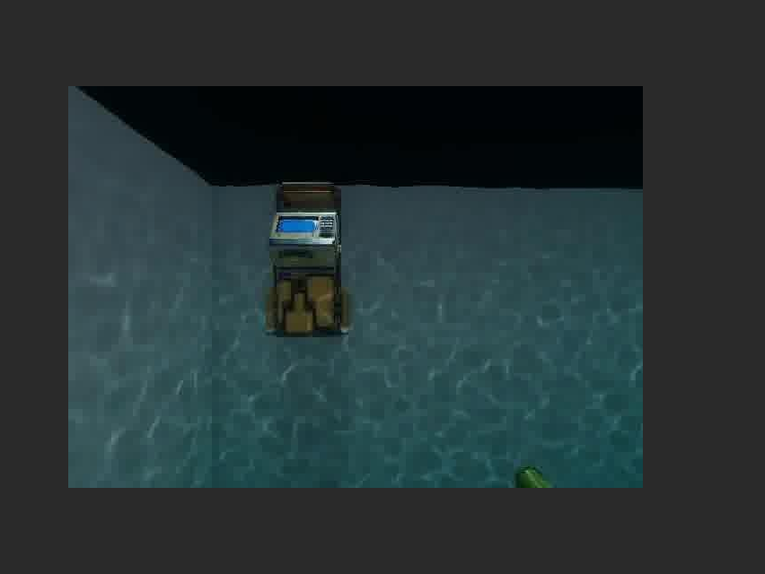
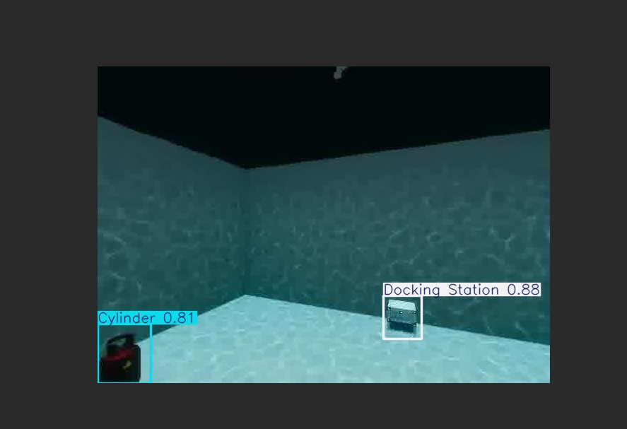
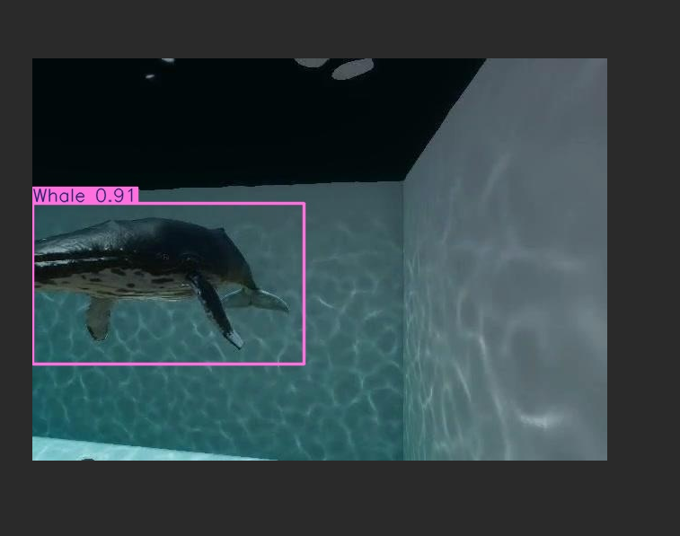
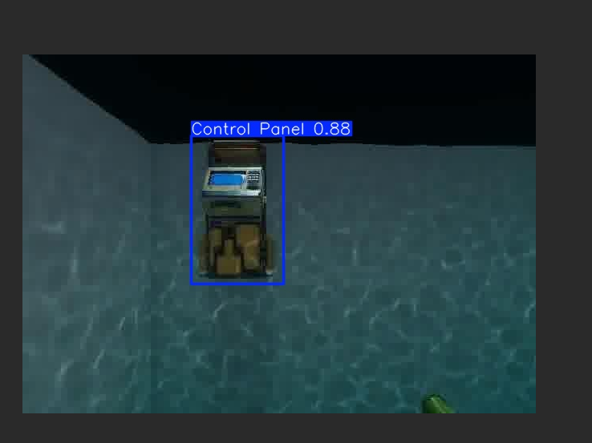

# Underwater Object Detection with YOLOv8

Fine-tuned YOLOv8n to detect 6 classes of underwater objects (Control Panel, Cylinder, Docking Station, Pipe, Shell, Whale). I built this to practise the full object-detection workflow on underwater images: baseline, fine-tuning, evaluation and error analysis.

## Dataset

"Underwater Objects Computer Vision Dataset" by Olamide Innocent, Roboflow Universe, licensed CC BY 4.0.
Link: https://universe.roboflow.com/olamide-innocent-vfde4/underwater-objects-mtgd5

475 images in total. Split used here: 383 train / 92 validation (there was no usable test split).

## What I did

1. Ran the pretrained YOLOv8n (trained on COCO) on the validation images as a baseline.
2. Fine-tuned YOLOv8n for 50 epochs on a free Colab T4 GPU (about 4 minutes).
3. Evaluated the best checkpoint on the validation set.

The full code and training log are in `notebook.ipynb`.

## Results (validation set, 92 images, 214 objects)

| Metric | Value |
|---|---|
| mAP50 | 0.975 |
| mAP50-95 | 0.657 |
| Precision | 0.971 |
| Recall | 0.949 |
| Inference speed | about 9 ms per image (T4 GPU) |

Per class:

| Class | mAP50 | mAP50-95 |
|---|---|---|
| Control Panel | 0.994 | 0.795 |
| Cylinder | 0.992 | 0.587 |
| Docking Station | 0.911 | 0.658 |
| Pipe | 0.995 | 0.693 |
| Shell | 0.984 | 0.518 |
| Whale | 0.973 | 0.690 |

Training curves:

Confusion matrix:

Pretrained COCO model (misses the objects or gives wrong labels):

Fine-tuned model:

## Baseline: what the pretrained model did

The pretrained COCO model does not know these classes, so it fails by design. On the 92 validation images it returned no detections on roughly 60% of them. On the rest it produced labels from everyday classes (boat, airplane, traffic light, truck, refrigerator, fire hydrant, bottle) that do not match the actual objects. Fine-tuning fixes this because the model learns the new classes.

## Limitations (please read before trusting the numbers)

- **The scores are probably too optimistic.** The file names (`ezgif-frame-...`) show the images are frames taken from a GIF or video, and the same frame appears more than once in the validation set with different augmentations. Near-identical frames are therefore likely shared between train and validation, which inflates the metrics.
- Small dataset, and no separate test split.
- Shell has only 9 validation examples, so its numbers are unreliable.
- The sample images on the dataset page look rendered or simulated, so I have not shown that this works on real pool or murky-water footage.

## Next steps

- Re-split the data by video or scene so near-duplicate frames cannot leak between train and validation.
- Test on real pool or turbid-water footage and look at how the model fails.
- Try underwater colour correction before detection.
- Collect and label my own underwater images of more object types, then retrain.

## Credit

Dataset: Olamide Innocent, Roboflow Universe (CC BY 4.0). Model: Ultralytics YOLOv8.